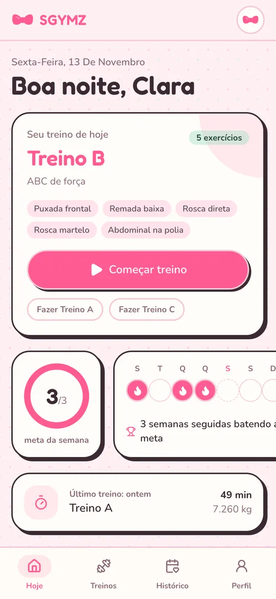
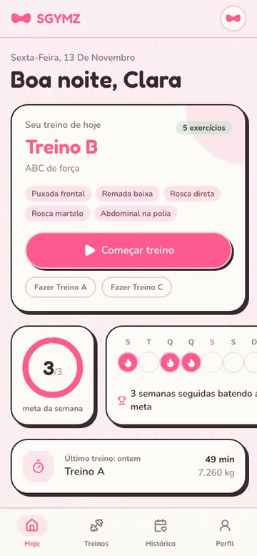
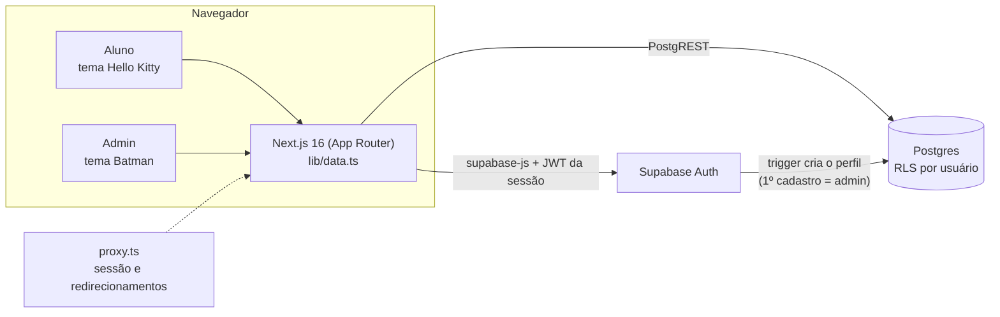
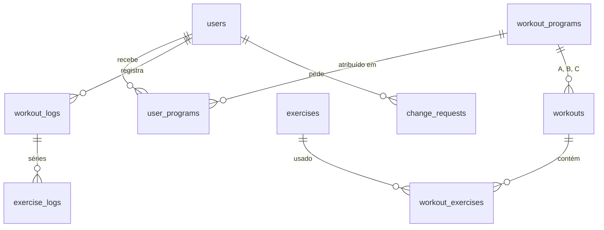

# SGYMZ

Gerenciador de treinos feito para dois: eu monto os programas no painel de admin (tema **Batman**) e minha namorada registra cada treino no celular, na academia (tema **Hello Kitty**). Next.js 16 + Supabase, instalável como app.

**Ao vivo:** [sgym-z.vercel.app](https://sgym-z.vercel.app)

<p align="center">
  
  
  
</p>

<sub>Dados fictícios. À esquerda e no meio, a mesma tela nos dois temas; à direita, um treino do começo ao fim e o painel do admin.</sub>

## O que dá para fazer

**Quem treina**
- Tela *Hoje* com o próximo treino da rotação (A → B → C), meta semanal em anel e sequência de semanas batendo a meta
- Modo treino: séries de aquecimento, preparação e válidas, carga e repetições já preenchidas com o último treino, timer de descanso com bipe e vibração, tela sempre acesa e progresso salvo no aparelho (dá para fechar o app e continuar)
- Finalização com nota do treino, anotações, resumo, confete e aviso de quais exercícios subiram de carga
- Histórico com calendário do mês e gráfico de evolução de carga por exercício
- Montar os próprios programas (em branco ou de um modelo pronto em `lib/templates.ts`), copiar um programa do admin para personalizar e pedir ajustes ao admin
- Troca de tema a qualquer momento; instalável como app (Adicionar à Tela de Início)

**Admin**
- Painel com alunos, treinos recentes e pedidos pendentes
- Atribuir programas, ver histórico e evolução de cada aluno, bloquear acesso e promover a admin
- Biblioteca de exercícios (50 exercícios em português já vêm cadastrados)
- Responder pedidos de ajuste

## Como funciona

Não há servidor próprio nem rotas de API. As páginas são Client Components que falam direto com o Supabase; quem decide o que cada conta pode ler ou gravar são as políticas RLS no Postgres.



Fluxo principal: o admin cria um programa com treinos A/B/C e atribui ao aluno → o aluno abre *Hoje*, inicia o treino da vez e registra as séries → ao concluir, o app grava `workout_logs` + `exercise_logs` → o admin vê o histórico e a evolução no painel e responde os pedidos de ajuste.

Modelo de dados, cada tabela, as políticas RLS em palavras e quais funções do app tocam em cada tabela: **[docs/database.md](docs/database.md)**.



## Stack

Next.js 16 (App Router, `proxy.ts`), React 19, TypeScript, Tailwind CSS 4, Supabase (Auth + Postgres + RLS) via `@supabase/ssr`, Zod e React Hook Form, Lucide. Bun como gerenciador de pacotes. Deploy na Vercel.

## Rodando localmente

Pré-requisitos: [Bun](https://bun.sh) e um projeto no [Supabase](https://supabase.com) (o plano grátis basta).

```bash
bun install
cp .env.example .env.local
bun dev            # http://localhost:3000
```

| Variável | Para que serve |
|---|---|
| `NEXT_PUBLIC_SUPABASE_URL` | URL do projeto (*Project Settings → API*). |
| `NEXT_PUBLIC_SUPABASE_ANON_KEY` | Chave pública `anon`. Pode ir para o navegador: o acesso é limitado pelo RLS. |

### Banco (uma vez)

1. No Supabase, abra **SQL Editor** e rode todo o arquivo [`supabase/setup.sql`](supabase/setup.sql). Ele recria as tabelas, as políticas RLS, os gatilhos e a biblioteca de exercícios. **Apaga treinos e histórico existentes**; as contas de login são mantidas.
2. Em **Authentication → Sign In / Providers → Email**, desligue **Confirm email** para entrar direto depois do cadastro.
3. Confira com `bun test-supabase.js`: ele consulta cada tabela com a anon key e diz se o setup foi aplicado.

O **primeiro cadastro** do sistema vira admin. Os demais entram como alunos e podem ser promovidos no painel.

### Scripts

| Comando | O que faz |
|---|---|
| `bun dev` | Servidor de desenvolvimento |
| `bun run build` | Build de produção |
| `bun start` | Sobe o build |
| `bun run lint` | ESLint |

## API

Não há API própria para documentar em Swagger. O Supabase gera sozinho uma especificação OpenAPI do PostgREST em `https://SEU-PROJETO.supabase.co/rest/v1/`, importável no Postman ou no Swagger Editor; o passo a passo está em [docs/database.md#swagger--postman](docs/database.md#swagger--postman).

## Estrutura

```
app/
  page.tsx                  escolha entre "Vim treinar" e "Painel do admin"
  login, register           entrada de quem treina
  (app)/                    área de quem treina: dashboard, treinos, historico, perfil
  (focus)/treino/[id]       modo treino em tela cheia
  admin/login, register     entrada do admin
  admin/(panel)/            painel: dashboard, usuarios, programas, exercicios, pedidos
components/                 shell, editor de programa, histórico, seletor de exercícios
components/ui/              botão, cartão, campos, stepper, sheet, toast...
hooks/use-theme.tsx         tema atual (localStorage + perfil)
lib/data.ts                 todas as consultas ao Supabase
lib/supabase/               clientes do navegador e do proxy
lib/templates.ts            modelos prontos de programa
types/database.ts           tipos que espelham o schema
proxy.ts                    renova a sessão e protege as rotas
supabase/setup.sql          schema completo, RLS e seed de exercícios
docs/                       banco de dados e mídia do README
```

Os temas são tokens CSS em `app/globals.css`. A variante `kitty:` do Tailwind aplica estilos só no tema Hello Kitty.

## Testes

Não há testes automatizados. A verificação é `bun run lint`, `bun run build` (que roda o TypeScript) e `bun test-supabase.js` para o banco.

## Deploy

Vercel, com as duas variáveis `NEXT_PUBLIC_SUPABASE_*` configuradas no projeto. Não precisa de mais nada: o banco é o mesmo Supabase.

## Licença

[MIT](LICENSE)
