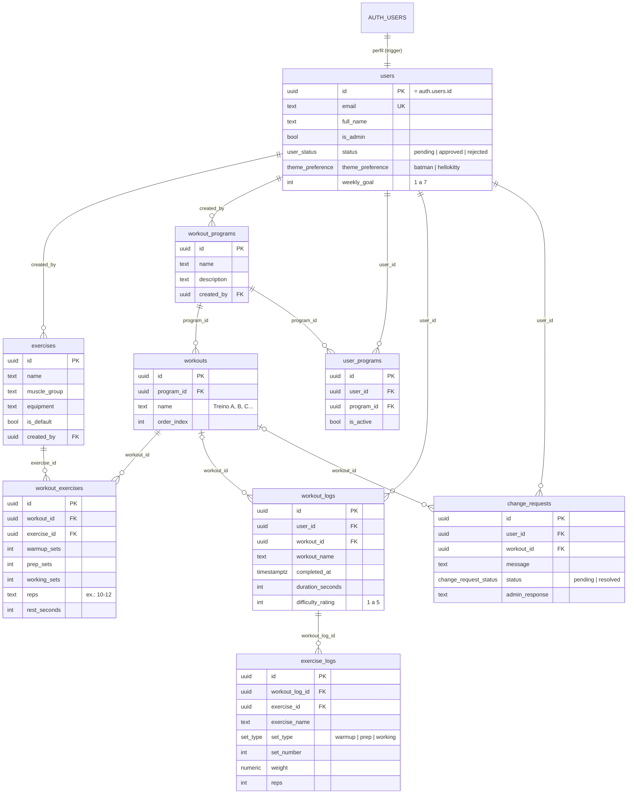
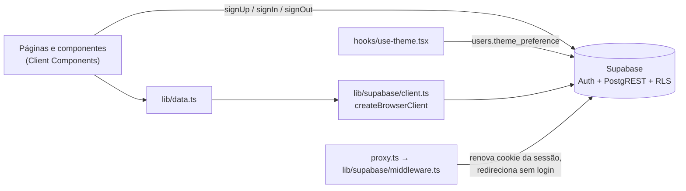

# Banco de dados

O SGYMZ não tem API própria. O backend é o Supabase: Auth para login, Postgres para os dados e Row Level Security (RLS) para decidir quem lê e escreve o quê. O navegador fala direto com o Postgres pela API REST do Supabase (PostgREST), usando a anon key e o token JWT da sessão. Toda a regra de acesso fica no banco.

Tudo vem de um único arquivo, [`supabase/setup.sql`](../supabase/setup.sql): tipos, tabelas, funções, gatilhos, políticas e a biblioteca de 50 exercícios. Ele é idempotente no sentido destrutivo: apaga e recria as tabelas do app (o histórico some), mas preserva as contas em `auth.users` e recria o perfil de cada uma.

## Diagrama



## Tabelas

| Tabela | Para que serve |
|---|---|
| `users` | Perfil de cada conta do Supabase Auth: nome, se é admin, status de acesso, tema e meta semanal de treinos. Criado pelo gatilho `on_auth_user_created`, nunca pelo app. |
| `exercises` | Biblioteca de exercícios. Os 50 padrão têm `is_default = true` e `created_by = NULL`; quem treina pode cadastrar os próprios. |
| `workout_programs` | Um programa (ex.: "ABC de força"), criado pelo admin ou pelo próprio aluno. |
| `workouts` | Os treinos de um programa (A, B, C...), na ordem de `order_index`. A rotação da tela *Hoje* segue essa ordem. |
| `workout_exercises` | Exercício dentro de um treino com a prescrição: séries de aquecimento, preparação e válidas, faixa de repetições, descanso e observação. |
| `user_programs` | Liga um programa a um aluno. `is_active` diz qual programa aparece na tela *Hoje*. Único por `(user_id, program_id)`. |
| `workout_logs` | Um treino concluído: duração, nota de dificuldade, anotações. Guarda `workout_name` em texto para o histórico sobreviver se o treino for apagado. |
| `exercise_logs` | Cada série feita dentro de um treino concluído (tipo, número, carga, repetições). Alimenta o gráfico de evolução e o pré-preenchimento do próximo treino. |
| `change_requests` | Pedido de ajuste do aluno ("posso trocar o leg press por hack squat?") e a resposta do admin. |

Os nomes de exercício e de treino são copiados para os logs (`exercise_name`, `workout_name`) e as FKs dos logs usam `ON DELETE SET NULL`: editar ou apagar um programa não destrói o histórico.

## Gatilhos

- **`handle_new_user`** (depois de inserir em `auth.users`): cria a linha em `users`. O **primeiro cadastro do sistema vira admin** com tema Batman; os demais entram como alunos (tema Hello Kitty, a menos que o cadastro peça outro). Todos entram com `status = 'approved'`.
- **`protect_user_columns`** (antes de atualizar `users`): quem não é admin não consegue mudar o próprio `is_admin` nem `status`, mesmo que a política de UPDATE deixe editar a própria linha. `email` nunca muda por aqui.
- **`assign_program_to_creator`** (depois de inserir em `workout_programs`): quando um aluno cria um programa, ele já entra na lista dele em `user_programs`.
- **`touch_updated_at`**: atualiza `updated_at` em `exercises`, `workout_programs` e `workouts`.

## Políticas RLS em palavras

Todas as tabelas têm RLS ligado e todas as políticas valem só para `authenticated`: sem login, a API não devolve nada. Quatro funções `SECURITY DEFINER` evitam recursão entre políticas:

- `is_admin()`: a conta logada é admin.
- `can_edit_program(id)`: é admin ou criou o programa.
- `can_access_program(id)`: pode editar o programa ou ele foi atribuído a você.
- `workout_program(id)`: devolve o programa de um treino (para as políticas de `workout_exercises`).

| Tabela | Ler | Criar | Alterar | Apagar |
|---|---|---|---|---|
| `users` | o próprio perfil; admin vê todos | ninguém (só o gatilho) | o próprio perfil (sem `is_admin`/`status`); admin altera qualquer um | só admin, e não a si mesmo |
| `exercises` | todos logados | qualquer um, em seu nome; só admin cria `is_default` | quem criou ou admin | quem criou ou admin |
| `workout_programs` | quem criou, quem recebeu, admin | qualquer um, em seu nome | quem criou ou admin | quem criou ou admin |
| `workouts` | quem acessa o programa | quem edita o programa | quem edita o programa | quem edita o programa |
| `workout_exercises` | quem acessa o programa do treino | quem edita o programa | quem edita o programa | quem edita o programa |
| `user_programs` | o próprio vínculo; admin vê todos | admin atribui a qualquer um; aluno só a si mesmo e só programa que ele criou | o dono (ativar/desativar) ou admin | o dono ou admin |
| `workout_logs` | o dono; admin vê todos | só o dono | só o dono | só o dono |
| `exercise_logs` | dono do treino concluído; admin | dono do treino concluído | dono do treino concluído | dono do treino concluído |
| `change_requests` | quem pediu; admin | o aluno, em seu nome | só admin (responder) | quem pediu ou admin |

Na prática:

- O admin monta programas e atribui; o aluno enxerga só o que é dele ou foi atribuído a ele.
- Um programa atribuído é somente leitura para o aluno. Para personalizar, ele copia (`duplicateProgram`) e a cópia passa a ser dele.
- O admin acompanha o histórico de todos, mas **não consegue registrar nem editar treinos em nome de ninguém**.
- Os exercícios padrão (`created_by = NULL`) só podem ser alterados ou removidos pelo admin.

**Limite conhecido:** o bloqueio de acesso (`status = 'rejected'`, botão "Bloquear" no painel) é aplicado pelo app (`components/auth-form.tsx` e `components/profile-gate.tsx` encerram a sessão ou mostram o aviso). As políticas RLS não olham `status`, então uma conta bloqueada que ainda tenha um token válido continua conseguindo ler e gravar os próprios dados direto pela API.

## Como o app usa o banco



- **`lib/supabase/client.ts`**: um cliente `@supabase/ssr` por aba, com `NEXT_PUBLIC_SUPABASE_URL` e `NEXT_PUBLIC_SUPABASE_ANON_KEY`.
- **`proxy.ts`** (o "middleware" do Next.js 16) chama `updateSession`: renova o cookie da sessão em cada request, manda quem não está logado para `/login` ou `/admin/login` e tira quem já está logado das telas de entrada.
- **`components/auth-form.tsx`**: cadastro e login (`supabase.auth.signUp` com `full_name` e `theme_preference` nos metadados, que o gatilho lê) e checagem de `status`.
- **`components/profile-gate.tsx`**: carrega o perfil antes das páginas internas e barra quem não é admin no painel.
- **`hooks/use-theme.tsx`**: salva a troca de tema em `localStorage` e em `users.theme_preference`.
- **`lib/data.ts`**: todas as outras consultas. Cada função lança erro se o Supabase devolver erro.

| Área | Funções em `lib/data.ts` | Tabelas |
|---|---|---|
| Perfil | `getProfile`, `updateProfile` | `users` |
| Programas | `listAssignedPrograms`, `listAllPrograms`, `getProgram`, `createProgram`, `updateProgram`, `deleteProgram`, `duplicateProgram`, `assignProgram`, `unassignProgram`, `setProgramActive` | `workout_programs`, `user_programs` (+ treinos e exercícios aninhados num único select) |
| Treinos | `addWorkout`, `renameWorkout`, `deleteWorkout`, `getWorkout`, `reorderRows` | `workouts` |
| Exercícios do treino | `addWorkoutExercise`, `updateWorkoutExercise`, `deleteWorkoutExercise` | `workout_exercises` |
| Biblioteca | `listExercises`, `createExercise`, `updateExercise`, `deleteExercise` | `exercises` |
| Histórico | `listLogs`, `deleteLog`, `lastSetsByExercise`, `saveWorkoutLog` | `workout_logs`, `exercise_logs` |
| Admin | `listUsers`, `getUser`, `updateUserAdmin` | `users` |
| Pedidos | `listChangeRequests`, `createChangeRequest`, `resolveChangeRequest`, `countPendingRequests` | `change_requests` |

`saveWorkoutLog` grava o treino e depois todas as séries num insert só; se as séries falharem, apaga o treino para não deixar log pela metade. `lastSetsByExercise` busca as últimas séries de cada exercício para pré-preencher carga e repetições no modo treino.

`lib/supabase/server.ts` (cliente para Server Components) existe, mas nenhuma página usa hoje: todas as telas são Client Components.

## Swagger / Postman

Não existe endpoint próprio para documentar. Quem quiser explorar a API que o app usa pode pegar a especificação OpenAPI que o PostgREST gera sozinho a partir do schema:

```bash
curl "https://SEU-PROJETO.supabase.co/rest/v1/" \
  -H "apikey: SUA_ANON_KEY" \
  -H "Authorization: Bearer SUA_ANON_KEY"
```

A resposta é um JSON OpenAPI 2.0 com todas as tabelas expostas; dá para importar no Postman (*Import → Raw text*) ou abrir no [Swagger Editor](https://editor.swagger.io). Para ver dados, troque o `Authorization` pelo `access_token` de uma sessão logada: com a anon key sozinha o RLS devolve listas vazias. Algumas versões do Supabase só servem essa especificação com a chave `service_role`; nesse caso use o painel (*API Docs*) do projeto, que mostra os mesmos recursos.
